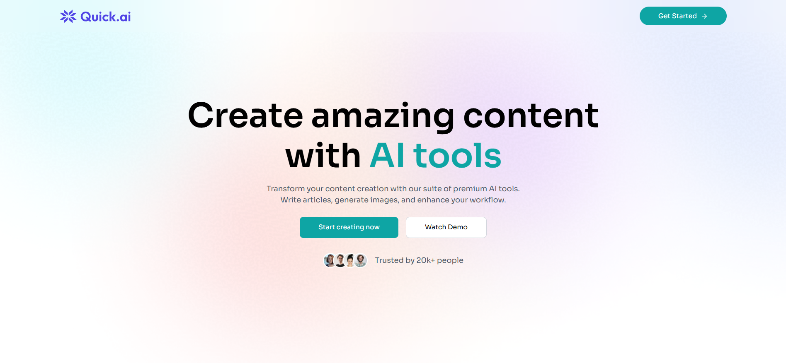
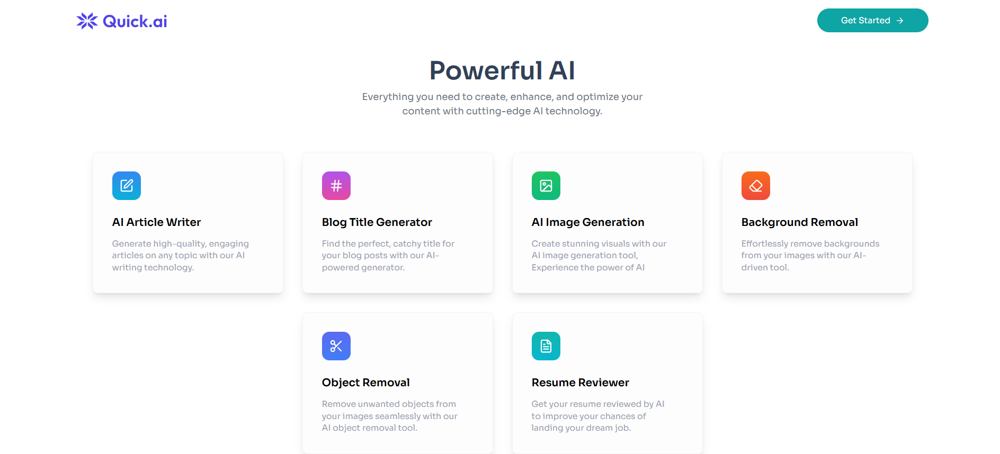
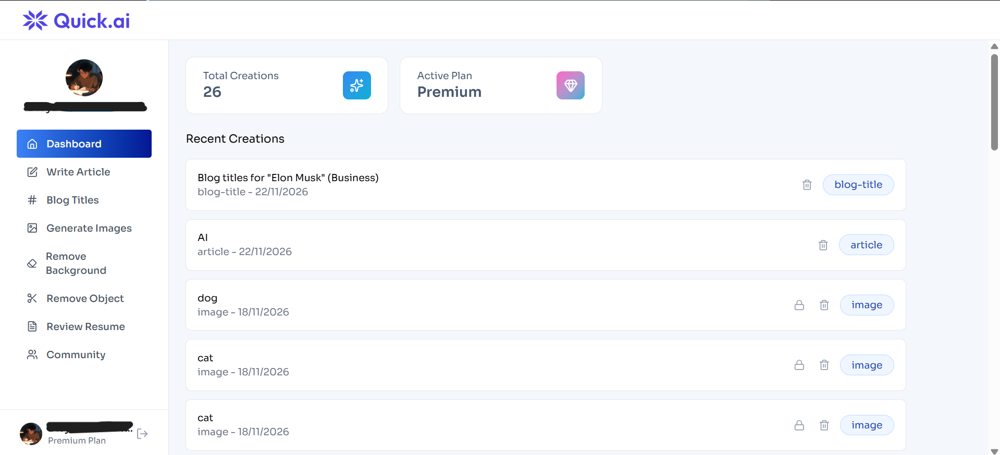
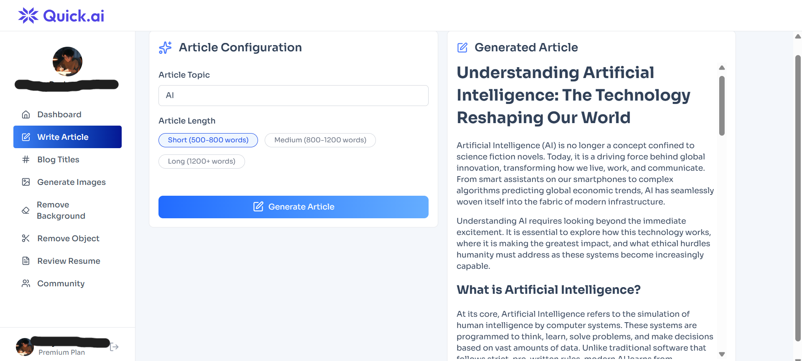
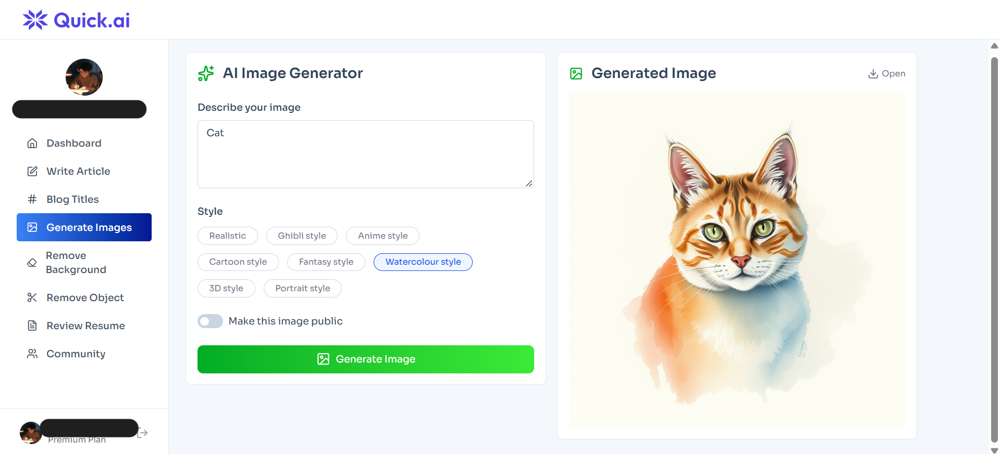
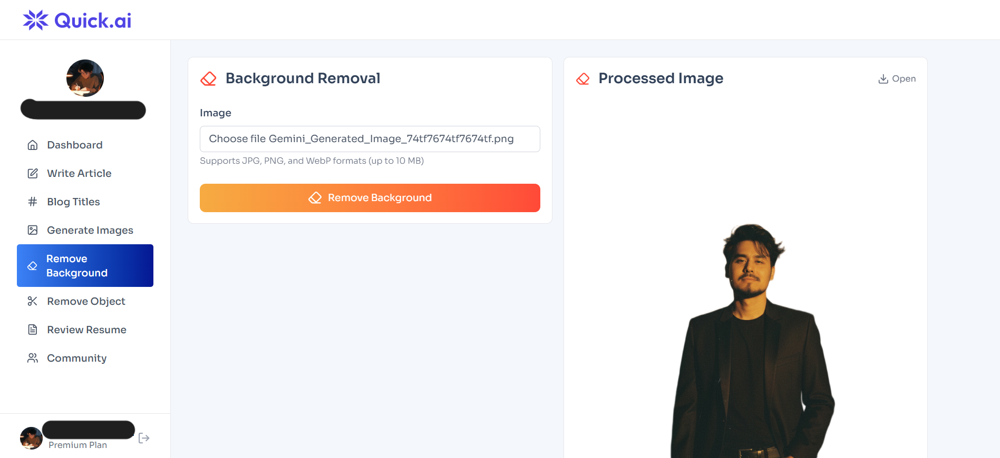
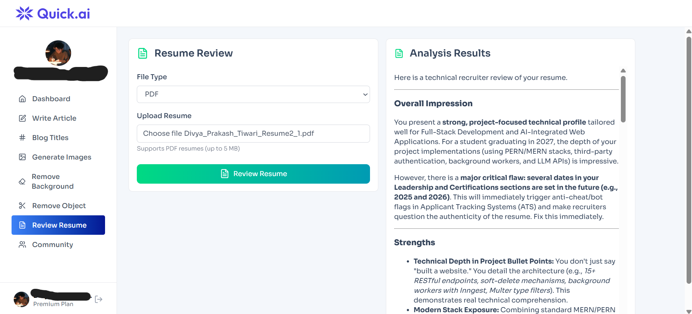
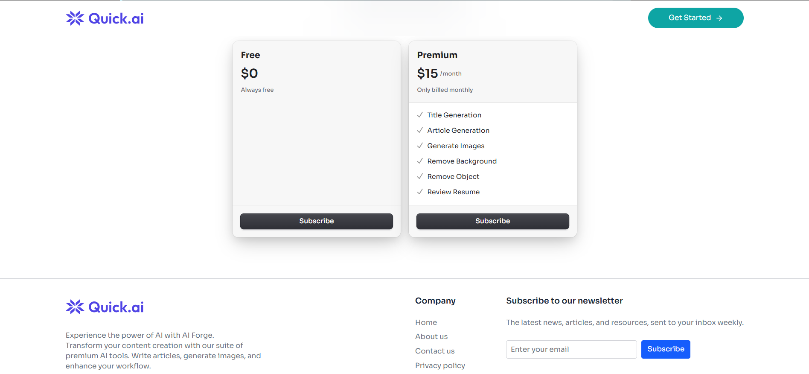

# Quick AI

Full Stack AI SaaS Platform built with the PERN stack.

A set of AI content tools behind a subscription: write articles, generate blog
titles and images, remove image backgrounds and objects, and get a resume
reviewed. Everything a user creates is saved, and generated images can be
published to a shared community feed.

## Live Demo

- **App:** https://quick-ai-2u5h.vercel.app

Sign up with Google or email to try the app. Write Article and Blog Titles
work on a free account. Generate Images, Remove Background, Remove Object and
Review Resume need the **Premium** plan, because each call uses a paid
third-party API.

## Screenshots

| Home | Features |
| :---: | :---: |
|  |  |

| Dashboard | Write Article |
| :---: | :---: |
|  |  |

| Generate Images | Remove Background |
| :---: | :---: |
|  |  |

| Review Resume | Footer |
| :---: | :---: |
|  |  |

## Stack

| Layer    | Choice                                                     |
| -------- | ---------------------------------------------------------- |
| Frontend | React 19 + Vite, Tailwind CSS v4, React Router             |
| Backend  | Node + Express 5 (ESM)                                     |
| Database | Postgres (Neon serverless)                                 |
| Auth     | Clerk (sessions, user profile, Billing / plan gating)      |
| Text AI  | Google Gemini via its OpenAI-compatible endpoint           |
| Images   | ClipDrop (text-to-image), Cloudinary (hosting + AI edits)  |
| Hosting  | Vercel (frontend and backend as separate projects)         |

## Features

- **Write Article** - long-form Markdown article from a topic and a target
  length (Short, Medium or Long).
- **Blog Titles** - ten title ideas for a keyword and category.
- **Generate Images** - text-to-image with eight style presets (Realistic,
  Ghibli, Anime, Cartoon, Fantasy, Watercolour, 3D, Portrait), optionally
  published to the community feed.
- **Remove Background** - AI background removal on an uploaded image.
- **Remove Object** - describe one object and have it generatively removed.
- **Review Resume** - upload a PDF, JPG or PNG resume and get structured
  feedback: overall impression, strengths, weaknesses, missing keywords and
  concrete improvements.
- **Dashboard** - every creation you have made, with publish and delete
  controls, plus your plan and remaining free usage.
- **Community** - published images from all users, with likes.

Free accounts get a metered allowance of the text tools
(`FREE_USAGE_LIMIT`, default 10). The image and resume tools are Premium-only
because each call hits a paid third-party API.

## How it works

```
User -> React app -> Clerk session -> Express API
     -> auth + plan check (free allowance or Premium)
     -> Gemini / ClipDrop / Cloudinary
     -> result saved in Neon Postgres -> JSON response -> React renders it
```

## Project layout

```
client/                 React + Vite frontend
  src/components/       Shared UI (Sidebar, ResultPanel, CreationItem, ...)
  src/pages/            Home, Layout, Dashboard, the six tools, Community
  src/hooks/useApi.js   Axios instance that attaches the Clerk session token
server/
  server.js             App wiring and listener
  configs/              env, db, ai, cloudinary, multer
  middlewares/          auth (authn gate + plan/usage limits), errorHandler
  controllers/          aiController, userController
  routes/               aiRoutes, userRoutes
  db/                   schema.sql and the idempotent boot migration
docs/screenshots/       Images used in this README
```

## Getting started

### 1. Accounts you will need

All of these have a free tier:

- [Neon](https://neon.tech) - Postgres connection string
- [Clerk](https://dashboard.clerk.com) - publishable + secret key
- [Google AI Studio](https://aistudio.google.com/apikey) - Gemini API key
- [ClipDrop](https://clipdrop.co/apis) - text-to-image API key (claim the free
  credits on your account page first)
- [Cloudinary](https://console.cloudinary.com) - cloud name, key, secret

### 2. Install

```bash
git clone https://github.com/DIVGIT01/quick-ai.git
cd quick-ai
npm run install:all
```

### 3. Configure

```bash
cp server/.env.example server/.env
cp client/.env.example client/.env
```

Fill both in. `DATABASE_URL`, `CLERK_PUBLISHABLE_KEY` and `CLERK_SECRET_KEY`
are required and the server refuses to start without them. The AI provider keys
are optional - leave one blank and the matching tool returns a clear "not
configured" error instead of crashing. The server logs which features are
disabled at boot.

`.env` files are gitignored. Keep them that way: only `VITE_`-prefixed values
reach the browser, so nothing secret belongs in `client/.env`.

### 4. Database

Nothing to run by hand. The server applies `server/db/schema.sql`'s contents
through `server/db/migrate.js` on every boot, and every statement is
idempotent. To set the schema up manually instead, run `server/db/schema.sql`
against your database.

### 5. Clerk Billing

The Premium gating reads a Clerk Billing plan whose slug must be `premium`.
In the Clerk dashboard: **Subscriptions -> Plans -> Add plan**, set the slug to
`premium`, and add it to your sign-up flow. The `<Protect plan="premium">`
components and the server-side `requirePremium` check both key off that slug.

### 6. Run

Two terminals:

```bash
npm run dev:server   # http://127.0.0.1:3000
npm run dev:client   # http://localhost:5173
```

The API binds to loopback by default. If you need to reach it from another
machine, put a reverse proxy or an SSH tunnel in front of it rather than
widening `HOST`.

## API

Every route requires a valid Clerk session token in the
`Authorization: Bearer <token>` header. `src/hooks/useApi.js` does this for the
frontend. Unauthenticated requests get `401`.

| Method   | Route                                | Plan    | Purpose                                |
| -------- | ------------------------------------ | ------- | -------------------------------------- |
| `GET`    | `/`                                  | public  | Health check + configured features     |
| `POST`   | `/api/ai/generate-article`           | metered | Markdown article                       |
| `POST`   | `/api/ai/generate-blog-title`        | metered | Title ideas                            |
| `POST`   | `/api/ai/generate-image`             | premium | Text-to-image                          |
| `POST`   | `/api/ai/remove-image-background`    | premium | Background removal                     |
| `POST`   | `/api/ai/remove-image-object`        | premium | Generative object removal              |
| `POST`   | `/api/ai/resume-review`              | premium | PDF / JPG / PNG resume feedback        |
| `GET`    | `/api/user/usage`                    | any     | Plan, free usage, totals               |
| `GET`    | `/api/user/get-user-creations`       | any     | Your creations                         |
| `GET`    | `/api/user/get-published-creations`  | any     | Community feed                         |
| `POST`   | `/api/user/toggle-like-creation`     | any     | Like / unlike                          |
| `POST`   | `/api/user/toggle-publish-creation`  | any     | Publish / unpublish your creation      |
| `DELETE` | `/api/user/creations/:id`            | any     | Delete your creation                   |

File uploads are `multipart/form-data`: field `image` for the two image
editors (JPEG/PNG/WebP, 10 MB max) and `resume` for the reviewer (PDF, JPG or
PNG, 5 MB max). Everything else is JSON.

## Deploying

The two halves deploy independently. The live app runs on Vercel as two
separate projects.

- **client** - build with `npm run build` and serve `client/dist` as a static
  site. Set `VITE_BASE_URL` to the deployed API origin at build time. Because
  the app is a single-page app, `client/vercel.json` rewrites every route to
  `index.html` so deep links like `/ai/write-article` still load:

  ```json
  { "rewrites": [{ "source": "/(.*)", "destination": "/index.html" }] }
  ```

- **server** - set every variable from `server/.env.example` in the host's
  environment settings (`.env` files are not uploaded). Set `ALLOWED_ORIGINS`
  to the deployed frontend origin (comma-separate several; no trailing slash)
  and `NODE_ENV=production` so internal error details stop being returned.
  Set `HOST=0.0.0.0` *only* when the platform terminates TLS and routes to
  your container. Redeploy after changing any variable.

## Team

- **Divya Prakash Tiwari** - React frontend, UI/UX design, Community feed, system architecture, deployment
- **Astha Negi** - Express backend, Gemini
  integration, subscription logic 


## License

MIT
